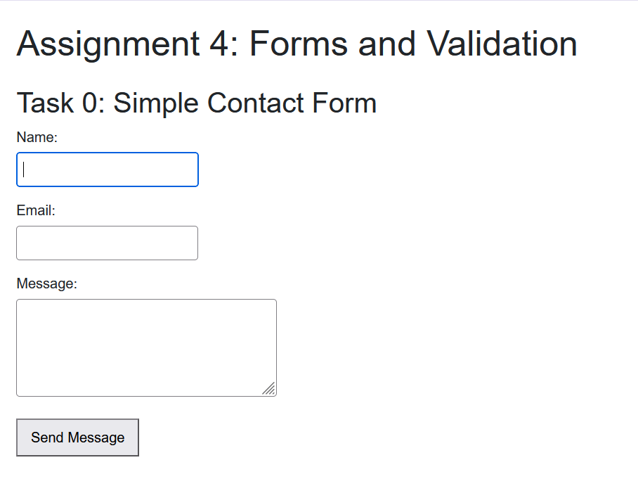
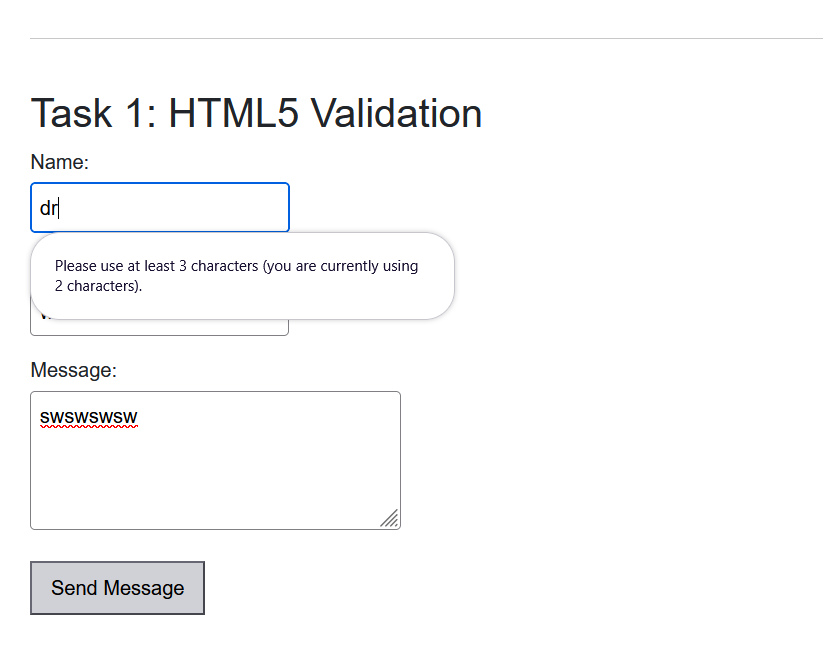
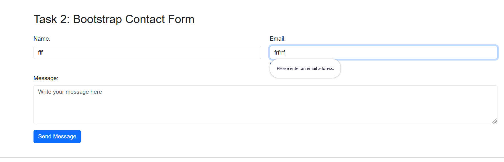
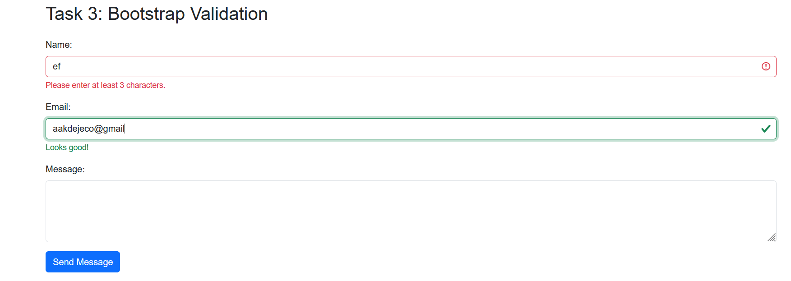
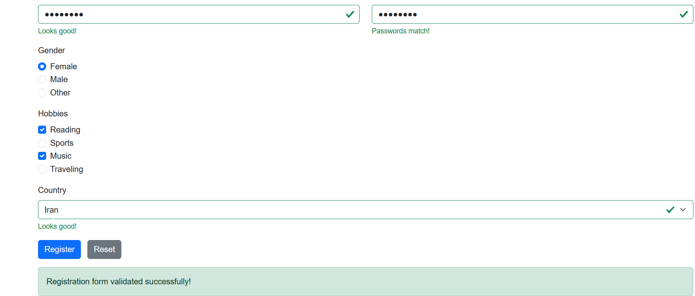

# Assignment 4: Forms and Validation

**Student:** Narges Jowkar  
**Group:** IT-2513

## Project Description

This project demonstrates HTML forms, HTML5 validation, Bootstrap styling, and JavaScript-based form validation.

## Completed Tasks

- **Task 0:** Basic HTML contact form with Name, Email, and Message fields.
- **Task 1:** HTML5 validation using `required`, `type`, `minlength`, and `maxlength`.
- **Task 2:** Bootstrap contact form using responsive grid layout, form controls, placeholders, and helper text.
- **Task 3:** Bootstrap validation using `is-valid`, `is-invalid`, and validation feedback messages.
- **Task 4:** Responsive registration form with personal information, password confirmation, gender selection, hobbies, country selection, and Submit/Reset buttons.

## Technologies Used

- HTML5
- CSS3
- Bootstrap 5
- JavaScript

## How to Run

Open `index.html` in a web browser. An internet connection is required to load Bootstrap from the CDN.

## Screenshots

### Task 0

### Task 1

### Task 2

### Task 3

### Task 4

## Work Summary

